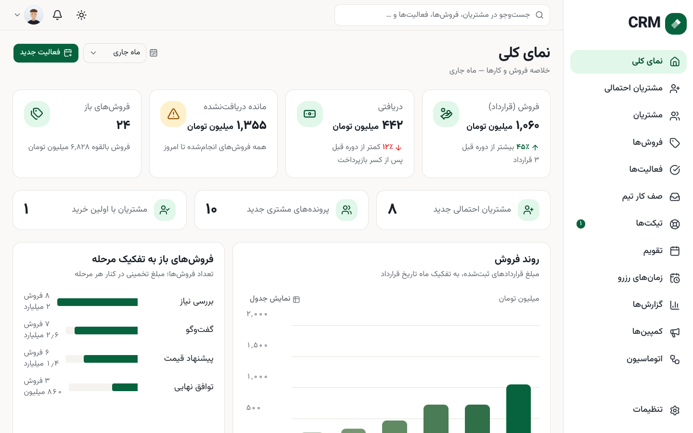
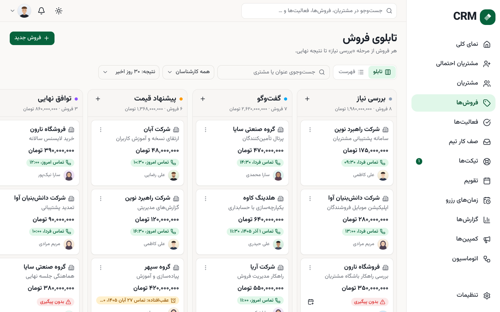
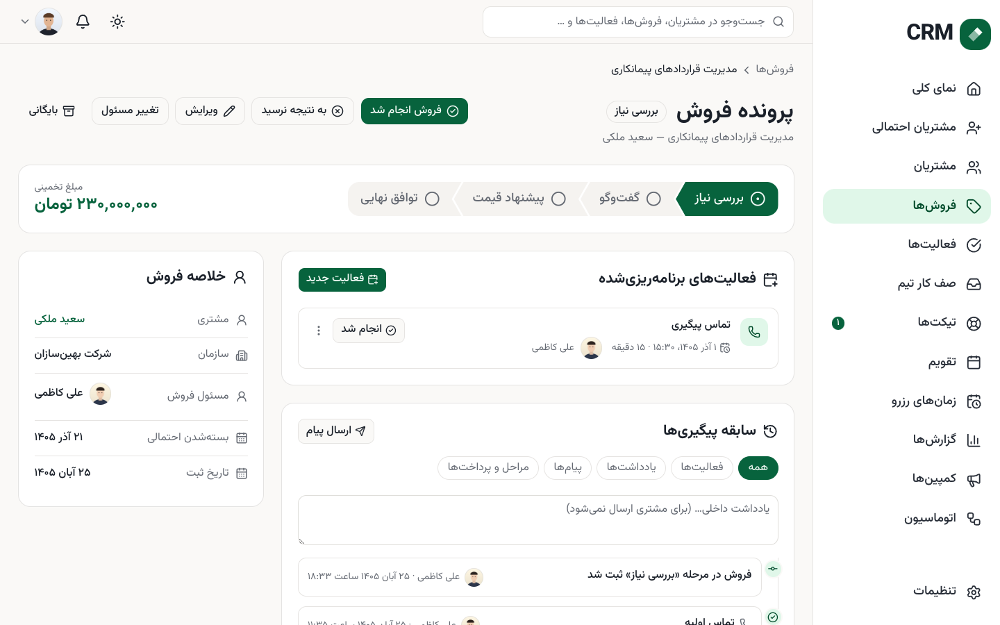
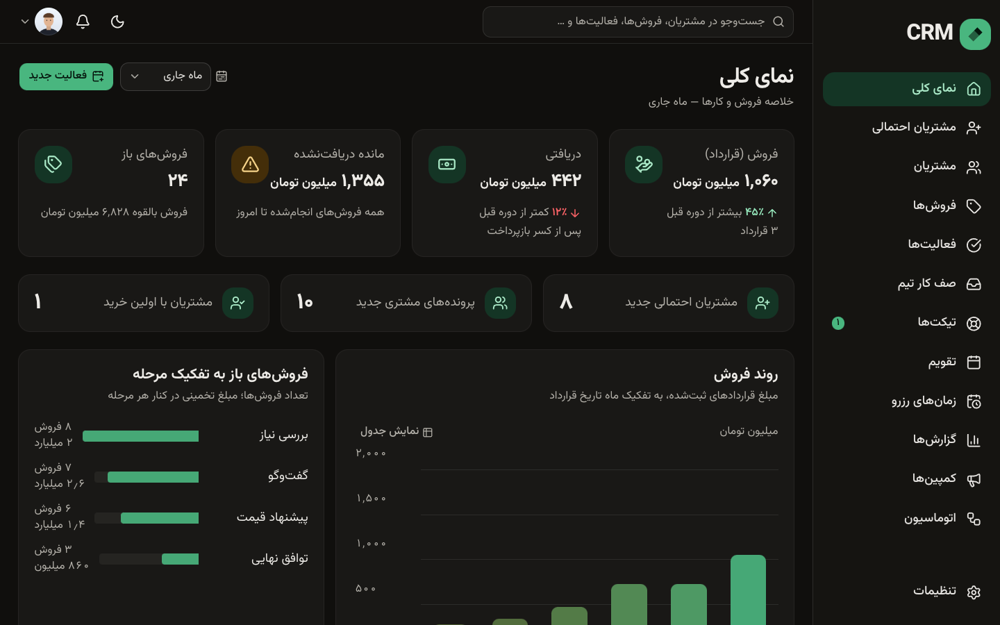

# CRM

A Persian, right-to-left CRM for managing leads, customers, deals and activities, with a Jalali calendar throughout.

[فارسی](README.fa.md) · [Product spec (Persian)](docs/crm-product-spec.fa.md)



All names, companies and numbers in the screenshots are fictional demo data (`seed-demo`).

## Screenshots

| Sales board | Deal |
| --- | --- |
|  |  |
| **Customers** | **Reports** |
|  |  |

Dark theme:



## Features

- **Sign-in** with a 5-digit one-time code by SMS or email; JWT sessions. There is no public sign-up.
- **Leads, customers and organizations**, with duplicate detection and lead-to-customer conversion.
- **Deals**: a drag-and-drop pipeline board, final outcome, payments and outstanding balance.
- **Activities**: day, week and month calendar, notes and a follow-up timeline on every record.
- **Overview and reports**: sales, receipts, pipeline by stage, source and team performance, each with a table view.
- **Campaigns** by SMS and email: chosen or filtered audiences, count and cost preview, test send, scheduling, throttled delivery within allowed hours, per-recipient results, suppression list and an unsubscribe link in every message.
- **Customer portal** (`/portal`): customers open and follow support tickets. Staff answer them in **Tickets** with public replies, internal notes, status and assignment.
- **Booking**: working hours, meeting types and time off per staff member; a link with free slots sent from the customer record; a booking page (`/book/...`) confirmed by one-time code; reschedule or cancel from the link or the portal.
- **Automation** with a visual builder, six templates, dry run, versioning and run history. Automatic SMS and email go only to contacts who have given consent.
- **Finance team queue**: automations add work to a queue; a member takes it or a manager assigns it.
- **In-app notifications**: activity reminders, assignments and a daily digest.
- **Settings**: users, teams, pipeline stages, lead sources, sent messages and the audit log.
- Profile photos, light, dark or system theme.
- **Roles**: admin, sales manager and sales rep. Reps see only the current status of other people's records.

## Stack

| Path | Contents |
| --- | --- |
| `apps/web` | Next.js 16, shadcn/ui (Base UI), Tailwind CSS v4, TanStack Query, Vazirmatn font |
| `apps/api` | FastAPI, SQLAlchemy 2, Alembic, PostgreSQL, Redis, RabbitMQ |
| `apps/api/app/modules` | One package per domain: `auth`, `identity`, `crm`, `sales`, `activities`, `booking`, `campaigns`, `tickets`, `automation`, `reports`, … |
| `tools/sms-sink` | SMS provider simulator for development and tests |
| `deploy/`, `infra/terraform` | Production images, Docker Compose and Terraform for a single VM on Google Cloud |
| `docs/` | Product spec (Persian) and screenshots |

## Running locally

Requirements: Docker, Node.js 24 with pnpm, and [uv](https://docs.astral.sh/uv/).

```bash
# Postgres, Redis, RabbitMQ, Mailpit and the SMS simulator
docker compose up -d --wait

# API: http://localhost:8000/docs
cd apps/api
cp .env.example .env
uv sync
uv run alembic upgrade head
uv run python -m app.cli create-user --name "Your name" --mobile 09xxxxxxxxx --role admin
uv run uvicorn app.main:app --reload
# in another terminal: SMS/email delivery, reminders and the daily digest
uv run python -m app.worker

# Web: http://localhost:3000
cd apps/web
pnpm install
pnpm dev
```

Roles for `create-user` are `admin`, `sales_manager` and `sales_rep`. Other users and teams are managed under **Settings**.

To fill the app with demo data like the screenshots (development and staging only):

```bash
uv run python -m app.cli seed-demo          # once
uv run python -m app.cli seed-demo --reset  # wipe business data (users and settings stay) and reseed
```

### SMS and email in development

Nothing is really sent. Messages go through the outbox and RabbitMQ to the worker, which delivers them to local inboxes:

- SMS: http://localhost:8030
- Email (Mailpit): http://localhost:8025

To sign in, enter the user's mobile or email at http://localhost:3000/login and take the code from one of these inboxes. Without the worker, set `CRM_MESSAGING_MODE=console` and the code is printed in the API log (development only).

## Checks

The same checks CI runs:

```bash
cd apps/web && pnpm lint && pnpm typecheck && pnpm build
cd apps/api && uv run ruff format --check . && uv run ruff check . && uv run mypy app tests && uv run pytest
```

API tests use a separate `crm_test` database and Redis DB 15.

## Deployment

`infra/terraform` creates one VM on Google Cloud running Docker Compose behind Caddy (HTTPS), with secrets in Secret Manager, a persistent data disk with daily snapshots and nightly database backups to Cloud Storage. `deploy/deploy.sh` builds the images with Cloud Build and rolls them out. Copy `infra/terraform/terraform.tfvars.example` to start.

## Security

This repository is public. No credentials, keys or real customer data belong in it. `terraform.tfvars` and Terraform state are git-ignored because they contain secrets. Outside development, `CRM_JWT_SECRET` and `CRM_OTP_SECRET` must be set or the API refuses to start.
