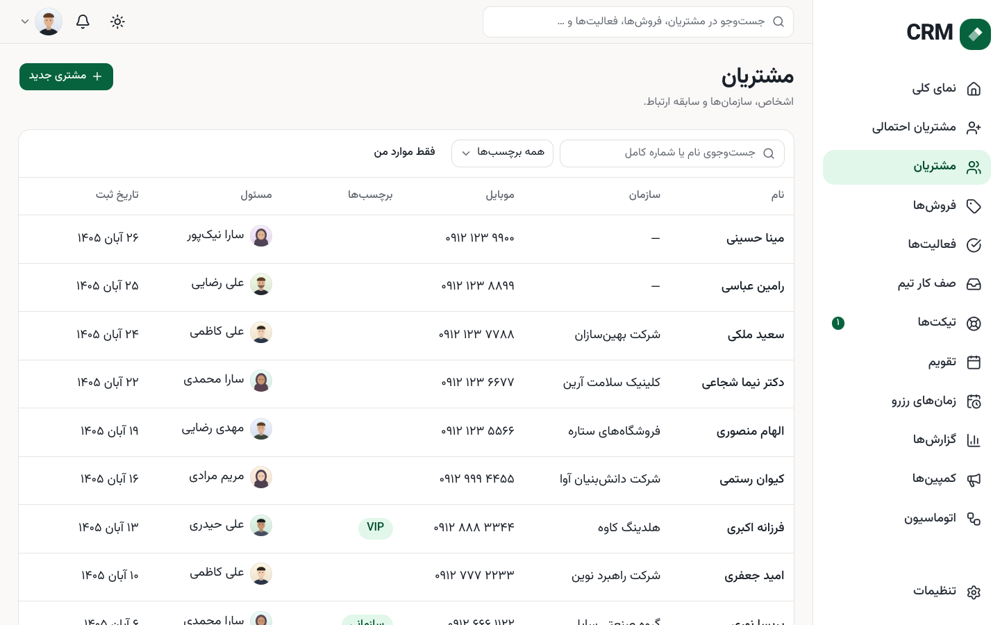
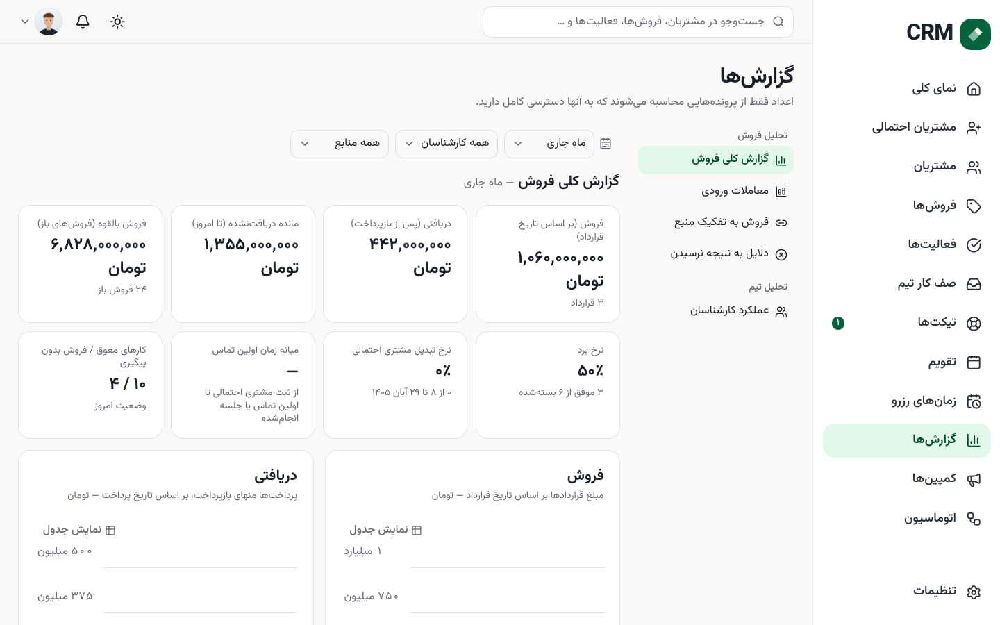
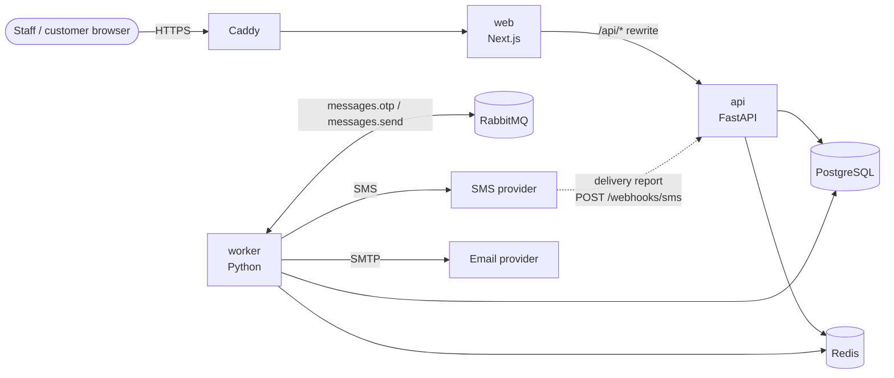
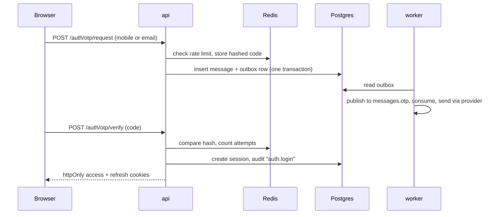

# CRM

A Persian, right-to-left CRM for managing leads, customers, deals and activities, with a Jalali calendar throughout.

[فارسی](README.fa.md) · [Product spec (Persian)](docs/crm-product-spec.fa.md)


All names, companies and numbers in the screenshots are fictional demo data (`seed-demo`).

## Screenshots

| Sales board | Deal |
| --- | --- |
|  |  |
| **Customers** | **Reports** |
|  |  |

Dark theme:


## Features

- **Sign-in** with a 5-digit one-time code by SMS or email; JWT sessions. There is no public sign-up.
- **Leads, customers and organizations**, with duplicate detection and lead-to-customer conversion.
- **Deals**: a drag-and-drop pipeline board, final outcome, payments and outstanding balance.
- **Activities**: day, week and month calendar, notes and a follow-up timeline on every record.
- **Overview and reports**: sales, receipts, pipeline by stage, source and team performance, each with a table view.
- **Campaigns** by SMS and email: chosen or filtered audiences, count and cost preview, test send, scheduling, throttled delivery within allowed hours, per-recipient results, suppression list and an unsubscribe link in every message.
- **Customer portal** (`/portal`): customers open and follow support tickets. Staff answer them in **Tickets** with public replies, internal notes, status and assignment.
- **Booking**: working hours, meeting types and time off per staff member; a link with free slots sent from the customer record; a booking page (`/book/...`) confirmed by one-time code; reschedule or cancel from the link or the portal.
- **Automation** with a visual builder, six templates, dry run, versioning and run history. Automatic SMS and email go only to contacts who have given consent.
- **Finance team queue**: automations add work to a queue; a member takes it or a manager assigns it.
- **In-app notifications**: activity reminders, assignments and a daily digest.
- **Settings**: users, teams, pipeline stages, lead sources, sent messages and the audit log.
- Profile photos, light, dark or system theme.
- **Roles**: admin, sales manager and sales rep. Reps see only the current status of other people's records.

## Architecture



The system is three processes built from two images, plus three stateful services:

| Component | Role |
| --- | --- |
| **web** (`apps/web`) | Next.js 16 app router, shadcn/ui on Base UI, Tailwind CSS v4, TanStack Query. Renders the staff app, the customer portal (`/portal`) and booking pages (`/book/...`). It rewrites `/api/*` to the API, so the browser only talks to one origin and auth cookies stay first-party. |
| **api** (`apps/api`) | FastAPI with SQLAlchemy 2 and Alembic. Stateless; any number can run. Handles every request and writes all side effects (messages, automation events) into Postgres in the same transaction as the change. |
| **worker** (`app/worker.py`) | One process, several loops: the outbox publisher, the RabbitMQ consumer that actually sends SMS/email, the reminder and daily-digest scheduler (30 s), the automation engine (3 s) and the campaign dispatcher (5 s). Safe to run more than one. |
| **PostgreSQL** | The source of truth: every record, the outbox, automation events and the audit log. Booking overlaps are prevented by a `btree_gist` exclusion constraint. |
| **Redis** | Short-lived state: one-time code challenges, rate limits and cooldowns, per-user daily send caps, and verified-visitor markers for the portal and booking links. |
| **RabbitMQ** | Delivery queues for outgoing messages, with per-message retry backoff and a dead-letter queue. |

### Backend modules

`apps/api/app/modules` has one package per domain. Each owns its models, schemas, service functions and router.

| Module | Responsibility |
| --- | --- |
| `auth` | One-time code request/verify, JWT access and refresh cookies, CSRF, session rotation |
| `identity` | Users, roles, teams, profile photos |
| `crm` | Leads, customers, organizations, tags, duplicate detection, lead conversion |
| `sales` | Pipelines and stages, deals, outcomes, payments |
| `activities` | Calls, meetings and tasks, the calendar, notes and the record timeline |
| `booking` | Availability, meeting types, time off, public booking links |
| `messaging` | Templates, the outbox, RabbitMQ topology, SMS/email providers, delivery webhooks |
| `campaigns` | Audiences, scheduling, throttled sending, suppression and unsubscribe |
| `automation` | Visual rule graphs, versions, event matching and run history |
| `notifications` | In-app notifications, reminders, daily digest |
| `tickets`, `portal` | Customer support tickets and the customer portal |
| `reports` | Overview and report aggregates, scoped to what the viewer may see |
| `audit` | Append-only audit log of sensitive actions |

Shared code lives in `app/core` (settings, Redis client, Jalali dates, phone and email normalization) and `app/db` (engine, session, base models).

### Data flows

**Sign-in with a one-time code**



The response to a code request is the same whether or not the account exists. Wrong codes, requests and resends are limited per destination and per IP.

**Outgoing SMS and email (transactional outbox).** No request ever calls a provider. The API writes the message and an outbox row in the same transaction as the business change, so a message exists if and only if the change committed. The worker's publisher moves outbox rows to RabbitMQ; the consumer sends through the provider and records the result. Temporary failures go to a `.retry` queue whose per-message TTL dead-letters them back after a backoff; permanent failures land in `messages.dead`. Each send is idempotent, so redelivery never sends twice. Providers report delivery later to `/webhooks/sms`.

**Automation.** Domain code calls `automation.events.emit(...)` inside its own transaction (for example "deal entered stage"). The worker's automation loop matches new events to active rule versions, evaluates conditions and runs actions: create an activity, assign, notify, add to the finance queue, or send a message through the outbox. Delays park a run and resume it later. A depth limit and dedupe keys stop rules from triggering each other forever.

**Campaigns.** The campaign loop starts scheduled campaigns and queues recipients in batches, only inside allowed sending hours and under the hourly cap. Suppressed and unsubscribed contacts are skipped, and each recipient's result is tracked.

**Booking.** A staff member sends a booking link from a customer record. The public page lists free slots computed from working hours, meeting types, time off and existing activities. The visitor confirms with a one-time code (audience `booking`); the API then creates the meeting under a per-calendar advisory lock, and the database's exclusion constraint guarantees no double booking even across API instances.

**Reminders and digest.** The scheduler loop turns due activities into in-app notifications and builds each user's daily digest; the web app polls for new notifications.

## Repository layout

| Path | Contents |
| --- | --- |
| `apps/web` | Next.js front end |
| `apps/api` | FastAPI back end, Alembic migrations, CLI (`create-user`, `seed-demo`) and tests |
| `tools/sms-sink` | SMS provider simulator for development and tests |
| `deploy/` | Production Docker Compose, Caddyfile, Cloud Build config and `deploy.sh` |
| `infra/terraform` | Google Cloud infrastructure |
| `docs/` | Product spec (Persian) and screenshots |

## Running locally

Requirements: Docker, Node.js 24 with pnpm, and [uv](https://docs.astral.sh/uv/).

```bash
# Postgres, Redis, RabbitMQ, Mailpit and the SMS simulator
docker compose up -d --wait

# API: http://localhost:8000/docs
cd apps/api
cp .env.example .env
uv sync
uv run alembic upgrade head
uv run python -m app.cli create-user --name "Your name" --mobile 09xxxxxxxxx --role admin
uv run uvicorn app.main:app --reload
# in another terminal: SMS/email delivery, reminders and the daily digest
uv run python -m app.worker

# Web: http://localhost:3000
cd apps/web
pnpm install
pnpm dev
```

Roles for `create-user` are `admin`, `sales_manager` and `sales_rep`. Other users and teams are managed under **Settings**.

To fill the app with demo data like the screenshots (development and staging only):

```bash
uv run python -m app.cli seed-demo          # once
uv run python -m app.cli seed-demo --reset  # wipe business data (users and settings stay) and reseed
```

### SMS and email in development

Nothing is really sent. Messages go through the outbox and RabbitMQ to the worker, which delivers them to local inboxes:

- SMS: http://localhost:8030
- Email (Mailpit): http://localhost:8025

To sign in, enter the user's mobile or email at http://localhost:3000/login and take the code from one of these inboxes. Without the worker, set `CRM_MESSAGING_MODE=console` and the code is printed in the API log (development only).

## Checks

The same checks CI runs:

```bash
cd apps/web && pnpm lint && pnpm typecheck && pnpm build
cd apps/api && uv run ruff format --check . && uv run ruff check . && uv run mypy app tests && uv run pytest
```

API tests use a separate `crm_test` database and Redis DB 15.

## Deployment

`infra/terraform` creates one VM on Google Cloud running Docker Compose behind Caddy (HTTPS), with secrets in Secret Manager, a persistent data disk with daily snapshots and nightly database backups to Cloud Storage. `deploy/deploy.sh` builds the images with Cloud Build and rolls them out. Copy `infra/terraform/terraform.tfvars.example` to start.

## Security

This repository is public. No credentials, keys or real customer data belong in it. `terraform.tfvars` and Terraform state are git-ignored because they contain secrets. Outside development, `CRM_JWT_SECRET` and `CRM_OTP_SECRET` must be set or the API refuses to start.
